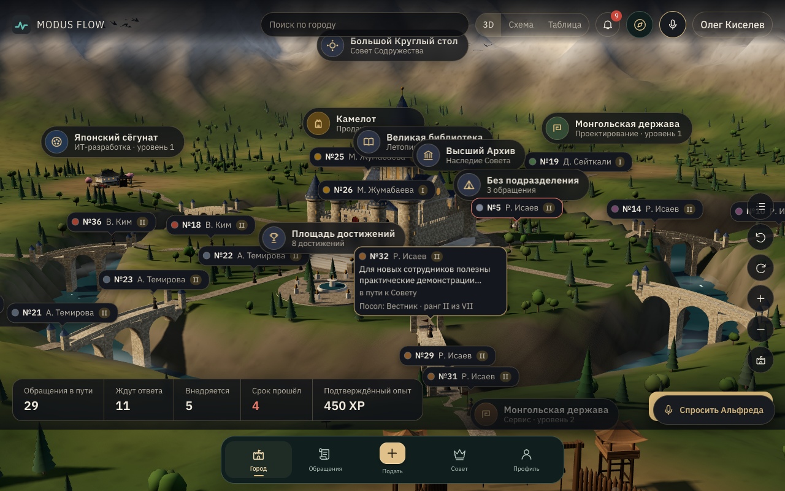

 

**A WORKPLACE SERVICE · FEEDBACK · DECISIONS · KNOWLEDGE**

### Good ideas deserve more than an inbox.

**MODUS FLOW** helps organizations listen to employees, make accountable decisions, verify implementation, and retain useful knowledge.

[Русский](README.md) · [Live demo](https://modus-flow-demo.vercel.app) · [How it works](#service-first) · [The Commonwealth](#why-the-commonwealth) · [What was added](#added-on-13-november-2026) · [Architecture](#architecture) · [Local demo](#run-the-demo)

---

## Service first.

Workplaces generate ideas, concerns, improvement requests and decisions every day. Much of that knowledge disappears into chat threads, and verifying what actually changed can be difficult.

**MODUS FLOW captures the complete lifecycle:** origin, owner, arguments, authorized decision, implementation, demonstrated impact and reusable learning. Its core is a traceable corporate workflow. The game-inspired presentation makes that workflow visible without changing the underlying permissions.

### How the service works

| 01 / Report | 02 / Ownership | 03 / Decide |
|:--|:--|:--|
| An employee raises an issue or submits an improvement. | An appropriate department, owner and deadline are assigned. | Authorized people review evidence and objections before deciding. |
| **04 / Deliver** | **05 / Verify** | **06 / Remember** |
| The work moves through a documented process. | The real implementation and impact are confirmed. | Learning progresses through the Chronicle, Library and Higher Archive. |

**Human judgment remains authoritative.** AI may advise, not automatically approve. The advisor is rule-based and labelled as such; a language model is optional, off by default, and where none is connected the interface says so instead of imitating one.

## Why the Commonwealth?

Because organizational work can be explored spatially instead of disappearing into another table.

  
  Original animated branding · Not recorded gameplay and not a shipped 3D scene

### Royal audience · cinematic preview

  
  Illustrative animation based on the audience prototype (PR #14), not recorded 3D gameplay or a Google Flow render.

An employee sends an envoy for their own issue. The King acknowledges receipt, and the sender sees a short cinematic scene. Review, formal implementation decisions and calling the Council remain **separate, authorized service workflows**. Accepting an envoy is not approving a proposal.

**We plan to produce the final desktop and mobile cinematic clips using [Google Flow](https://labs.google/fx/tools/flow).** Only anonymous, faceless silhouettes are allowed — no human faces or portraits. Until approved footage exists, the preview above shows an animated SVG representation of the current prototype.

**Since 13 November 2026 the app plays short cinematic notifications** ([ADR-0037](docs/adr/0037-cinematic-notifications.md), [ADR-0042](docs/adr/0042-contribution-confirmed-and-great-council.md)): a scene is shown only for an event confirmed by the server, once per device; with reduced motion or light graphics a still frame replaces the video. A nine-second intro plays when the app is opened and can be skipped with a button or Esc.

[Royal audience prototype — PR #14](https://github.com/airtrio-security-lab/modus-flow/pull/14) · [Google Flow video pipeline](docs/GOOGLE_FLOW_CINEMATICS.md)

The **Great Commonwealth** is an optional visual workspace **over the service**. An organization stays one tenant. Each department can select a district aesthetic and hosts a Small Council. The Great Round Table serves the whole organization.

| District culture | Architectural language | Small Council |
|:--|:--|:--|
| **Camelot** | Castles, masonry, towers and workshops | Knights' Hall |
| **Japanese Shogunate** | Tiered castles, gardens, wooden walkways | Daimyō Hall |
| **Kazakh Khanate** | Khan's orda, yurts and steppe settlement | Khan's Yurt |
| **Mongol Realm** | Encampments, banners, nomadic structures | Noyons' Council |
| **Russian Tsardom** | Red-brick kremlin, tent-roofed towers, white-stone cathedrals, trading rows | Boyar Duma |

A civilization is a visual department setting: **it never changes access rights, XP rules, pay or job roles**. The standard non-graphic workplace stays available.

## Progress backed by evidence

In the platform, an append-only XP ledger is linked to confirmed implementation and impact. Merely filing an idea grants no progress. Database-level constraints prevent duplicate awards for a single qualifying event.

**A person → an issue → a decision → implementation → evidence → knowledge.**

## Added on 13 November 2026

Everything below is in `main` and was checked locally. Each decision has an ADR (in Russian) with a section of stated limitations.

| What | In short | Decision |
|:--|:--|:--|
| **Live demo** | [modus-flow-demo.vercel.app](https://modus-flow-demo.vercel.app): UI on Vercel's CDN, the API as one function, the database in Neon; fictional data only | [ADR-0033](docs/adr/0033-hosted-demo-vercel-neon.md) |
| **Kingdom sign-in** | New demo sign-in screen for desktop and phone; an opening intro video | — |
| **Cinematic notifications** | Short scenes for server-confirmed events: envoy sent, envoy accepted, implementation approved, contribution recognised, the Great Council gathered and others | [ADR-0037](docs/adr/0037-cinematic-notifications.md), [ADR-0042](docs/adr/0042-contribution-confirmed-and-great-council.md) |
| **Living envoy** | One employee, one envoy that develops; its states come only from server facts | [ADR-0036](docs/adr/0036-living-envoy.md) |
| **"Problem solved"** | Confirmed by the author of the issue, once, and only after a confirmed implementation | [ADR-0035](docs/adr/0035-problem-resolution-by-author.md) |
| **Palace, Great Library, High Archive** | Knowledge screens live in the same world as the city | [ADR-0034](docs/adr/0034-palace-library-archive.md) |
| **Solution path and "Apply this method"** | The path is built from recorded facts; reuse is an ordinary issue linked to the knowledge item, with no XP | [ADR-0040](docs/adr/0040-solution-path-method-reuse.md) |
| **Library catalogue** | Server-side pages, exact counts under RLS, filters in the address; keyword search, not semantic | [ADR-0041](docs/adr/0041-library-paged-search.md) |
| **Seamless world** | Leaving a building returns you to the same city, camera and selection | [ADR-0038](docs/adr/0038-seamless-world.md) |
| **3D performance** | A reproducible measurement profile; the built world is kept for 120 s instead of being rebuilt | [ADR-0039](docs/adr/0039-performance-profile-kept-world.md) |
| **"Ask the advisor"** | A voice assistant over MODUS FLOW data: the employee's own rights, read-only tools, conversations are not recorded. Off by default; without a provider a text mode works | [ADR-0043](docs/adr/0043-voice-advisor.md) |
| **Living city** | Cloud shadows, clouds, shafts of light, birds and smoke over the 3D city — decoration, not data | [ADR-0044](docs/adr/0044-living-city-weather.md) |
| **Living city details** | Smoke from hearths, glints and mist in the gorge, petals, dust and leaves by civilization, fountain spray | [ADR-0045](docs/adr/0045-living-city-details.md) |
| **Unified style and phone** | One Commonwealth style on every screen, a navigation dock on phones | — |

  
  Screenshot of the real application: the living city (ADR-0044) · demo data · software rendering, not a video recording

## Architecture

**\`main\`** contains the React / TypeScript / Node.js / PostgreSQL 16 platform: issues with routing and deadlines, decisions with history, row-level access control, councils and meetings, knowledge, a mobile PWA. The Commonwealth city has three views of the same data and rights: a Three.js 3D scene, an SVG schematic and an ordinary work table. The early standalone Node.js demo is kept alongside.

| Component | Technology / approach |
|:--|:--|
| Platform | React, TypeScript, Vite, Node.js, PostgreSQL 16, RLS |
| Decisions and evidence | Authorized API, domain rules, history and idempotent XP |
| Commonwealth city | Three.js (procedural models and materials, no third-party assets), SVG fallback, work table |
| District town | Painted panorama (Camelot, Russian Tsardom) and the same town in 3D |
| Language model | Optional and off by default; without it the interface says "not connected" |
| Voice advisor | Optional and off by default; OpenAI Realtime (WebRTC), the key never leaves the server; real data only with a separate switch |
| Live demo | Vercel (static files and one API function) + Neon PostgreSQL; demo data only |
| Access | Desktop/mobile web |
| Early demo | Node.js, browser UI, native Node test runner |

**Not done and not verified yet.** The 3D scene is procedural geometry and is below the concept art above; there are no authored 3D models and no residents in the streets. Frame rate was measured on one desktop (Chrome on Apple M5: median 5 ms between frames, p90 10 ms at ~600k triangles) and the phone layout in emulation only: weak GPUs and real phones are still to be tested. The living-city weather layer was measured in software rendering only. The voice advisor has not been tested with a real microphone. Cold start and load from several viewers were not measured for the live demo. Project checks run locally; GitHub CI is not running at the moment.

**Security:** this is an evolving system, **not approved to handle real employee information in production**. Real authentication, operational controls and privacy/legal reviews are still required.

## Run the demo

**Live demo** (nothing to install): [modus-flow-demo.vercel.app](https://modus-flow-demo.vercel.app). Sign in as any demo persona; all data is fictional; the AI assistant and voice are not connected there.

**Platform with demo data** (macOS / Linux, Node.js ≥ 22.18, Docker running for PostgreSQL 16; all people and issues are fictional):

~~~bash
git clone https://github.com/airtrio-security-lab/modus-flow.git
cd modus-flow
./scripts/demo-local.sh --fresh --dataset
# http://127.0.0.1:3100
~~~

Details, tests and the local release gate: [DEVELOPMENT.md](DEVELOPMENT.md). 3D city walkthrough: [docs/demo/world3d-demo.md](docs/demo/world3d-demo.md); living city: [docs/demo/weather-demo.md](docs/demo/weather-demo.md); voice advisor: [docs/demo/voice-advisor-90s.md](docs/demo/voice-advisor-90s.md) (all in Russian).

The AI assistant is connected with the `--ai` flag (cloud model Claude Haiku; the Anthropic key is asked on its own line, [ADR-0028](docs/adr/0028-cloud-model.md)). The voice advisor is enabled with `MODUS_VOICE_PROVIDER=openai` and `OPENAI_API_KEY` ([ADR-0043](docs/adr/0043-voice-advisor.md)). Everything else works without keys.

**Early standalone demo** (no database):

~~~bash
npm ci
DEMO_MODE=true npm start
# http://localhost:3000
~~~

The demo sign-in is intentionally insecure. **Never put it on the public internet or use real staff data.** The live demo is a separate build with an explicit switch and fictional data only ([ADR-0033](docs/adr/0033-hosted-demo-vercel-neon.md)).

## Art direction and identity

Our ambition is premium cinematic quality with architectural credibility, controlled light, refined materials and restrained type. **No human faces or photoreal portraits in brand imagery and game avatars:** use anonymous faceless silhouettes, figures seen from behind, crests or other non-identifying forms. Never represent visual characters as real employee identities.

All visual material must be original or appropriately licensed. Do not copy Apple, Rockstar, Blizzard or other studios' protected artwork. See [Brand & Art Direction](docs/BRAND_DIRECTION.md).

## Engineering with evidence

Built by **Air Trio Security Lab**, MODUS FLOW separates verified capabilities, isolated demos and the future 3D vision. No imaginary AI features, fake performance numbers or conceptual screenshots presented as production footage.

---

### MODUS FLOW

**Turn feedback into decisions. Turn decisions into organizational knowledge.**

Air Trio Security Lab · Kazakhstan · Public repository · All rights reserved unless separately licensed

