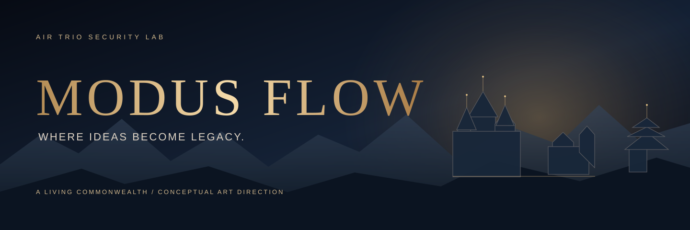
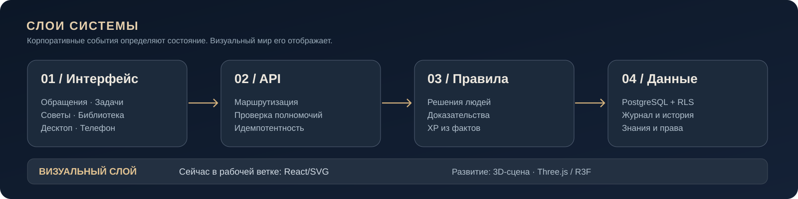

 

**A WORKPLACE SERVICE · FEEDBACK · DECISIONS · KNOWLEDGE**

### Good ideas deserve more than an inbox.

**MODUS FLOW** helps organizations listen to employees, make accountable decisions, verify implementation, and retain useful knowledge.

[Русский](README.md) · [How it works](#service-first) · [The Commonwealth](#why-the-commonwealth) · [Architecture](#architecture) · [Local demo](#run-the-demo)

---

## Service first.

Workplaces generate ideas, concerns, improvement requests and decisions every day. Much of that knowledge disappears into chat threads, and verifying what actually changed can be difficult.

**MODUS FLOW captures the complete lifecycle:** origin, owner, arguments, authorized decision, implementation, demonstrated impact and reusable learning. Its core is a traceable corporate workflow. The game-inspired presentation makes that workflow visible without changing the underlying permissions.

### How the service works

| 01 / Report | 02 / Ownership | 03 / Decide |
|:--|:--|:--|
| An employee raises an issue or submits an improvement. | An appropriate department, owner and deadline are assigned. | Authorized people review evidence and objections before deciding. |
| **04 / Deliver** | **05 / Verify** | **06 / Remember** |
| The work moves through a documented process. | The real implementation and impact are confirmed. | Learning progresses through the Chronicle, Library and Higher Archive. |

**Human judgment remains authoritative.** AI may advise, not automatically approve. The current advisor is rule-based, clearly labelled as such; a connected LLM is not shipped.

## Why the Commonwealth?

Because organizational work can be explored spatially instead of disappearing into another table.

  
  Original animated branding · Not recorded gameplay and not a shipped 3D scene

### Royal audience · cinematic preview

  
  Illustrative animation based on the audience prototype (PR #14), not recorded 3D gameplay or a Google Flow render.

An employee sends an envoy for their own issue. The King acknowledges receipt, and the sender sees a short cinematic scene. Review, formal implementation decisions and calling the Council remain **separate, authorized service workflows**. Accepting an envoy is not approving a proposal.

**We plan to produce the final desktop and mobile cinematic clips using [Google Flow](https://labs.google/fx/tools/flow).** Only anonymous, faceless silhouettes are allowed — no human faces or portraits. Until approved footage exists, the preview above shows an animated SVG representation of the current prototype.

[Royal audience prototype — PR #14](https://github.com/airtrio-security-lab/modus-flow/pull/14) · [Google Flow video pipeline](docs/GOOGLE_FLOW_CINEMATICS.md)

The **Great Commonwealth** is an optional visual workspace **over the service**. An organization stays one tenant. Each department can select a district aesthetic and hosts a Small Council. The Great Round Table serves the whole organization.

| District culture | Architectural language | Small Council |
|:--|:--|:--|
| **Camelot** | Castles, masonry, towers and workshops | Knights' Hall |
| **Japanese Shogunate** | Tiered castles, gardens, wooden walkways | Daimyō Hall |
| **Kazakh Khanate** | Khan's orda, yurts and steppe settlement | Khan's Yurt |
| **Mongol Realm** | Encampments, banners, nomadic structures | Noyons' Council |

A civilization is a visual department setting: **it never changes access rights, XP rules, pay or job roles**. The standard non-graphic workplace stays available.

## Progress backed by evidence

In the experimental platform branch, an append-only XP ledger is linked to confirmed implementation and impact. Merely filing an idea grants no progress. Database-level constraints prevent duplicate awards for a single qualifying event.

**A person → an issue → a decision → implementation → evidence → knowledge.**

## Architecture

**Current \`main\`:** isolated Node.js demo with employee submission, role-scoped state transitions, status history and Russian UI. The active [\`feat/kingdom-map\` branch](../../tree/feat/kingdom-map) contains a broader React / TypeScript / PostgreSQL platform, departmental councils, knowledge and a responsive SVG city. Cinematic Three.js / React Three Fiber 3D is a **development direction**, not a shipped capability.

| Component | Technology / approach |
|:--|:--|
| Early demo in \`main\` | Node.js, browser UI, native Node test runner |
| Active platform branch | React, TypeScript, Vite, Node.js, PostgreSQL 16, RLS |
| Decisions and evidence | Authorized API, domain rules, history and idempotent XP |
| Current visual city | React/SVG and ordinary non-graphic workflow |
| 3D art direction | Three.js / React Three Fiber, subject to implementation |
| Access | Desktop/mobile web; physical-device 3D testing pending |

**Security:** this is an evolving system, **not approved to handle real employee information in production**. Real authentication, operational controls and privacy/legal reviews are still required.

## Run the demo

Current **\`main\`** supports an isolated demo using Node.js ≥ 22.

~~~bash
git clone https://github.com/airtrio-security-lab/modus-flow.git
cd modus-flow
npm ci
DEMO_MODE=true npm start
# http://localhost:3000

npm test
~~~

The demo exposes example bearer tokens in browser source. **Never put it on the public internet or use real staff data.** For the PostgreSQL platform see the [feature branch README](../../blob/feat/kingdom-map/README.md).

## Art direction and identity

Our ambition is premium cinematic quality with architectural credibility, controlled light, refined materials and restrained type. **No human faces or photoreal portraits in brand imagery and game avatars:** use anonymous faceless silhouettes, figures seen from behind, crests or other non-identifying forms. Never represent visual characters as real employee identities.

All visual material must be original or appropriately licensed. Do not copy Apple, Rockstar, Blizzard or other studios' protected artwork. See [Brand & Art Direction](docs/BRAND_DIRECTION.md).

## Engineering with evidence

Built by **Air Trio Security Lab**, MODUS FLOW separates verified capabilities, isolated demos and the future 3D vision. No imaginary AI features, fake performance numbers or conceptual screenshots presented as production footage.

---

### MODUS FLOW

**Turn feedback into decisions. Turn decisions into organizational knowledge.**

Air Trio Security Lab · Kazakhstan · Private repository · All rights reserved unless separately licensed

