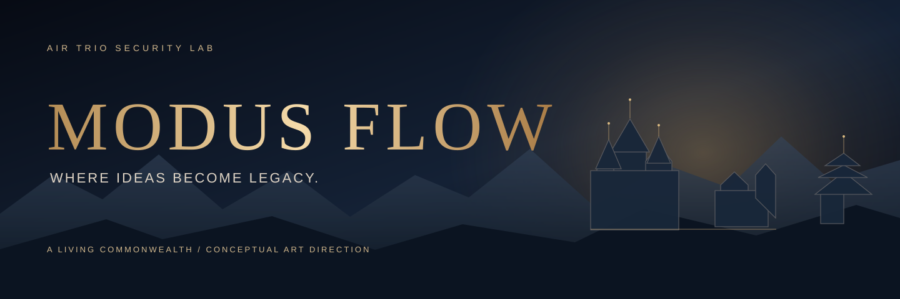
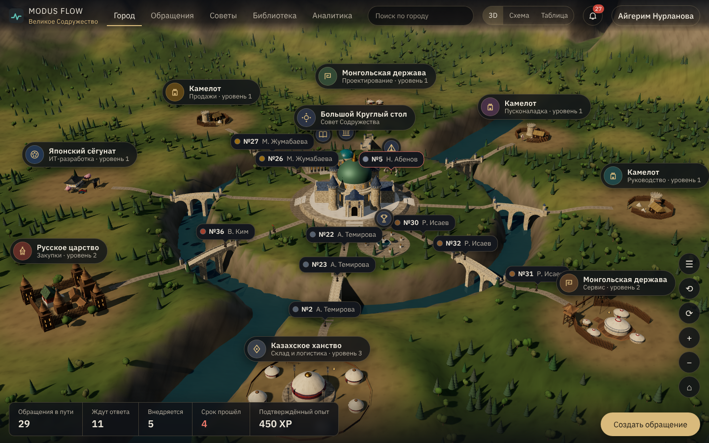
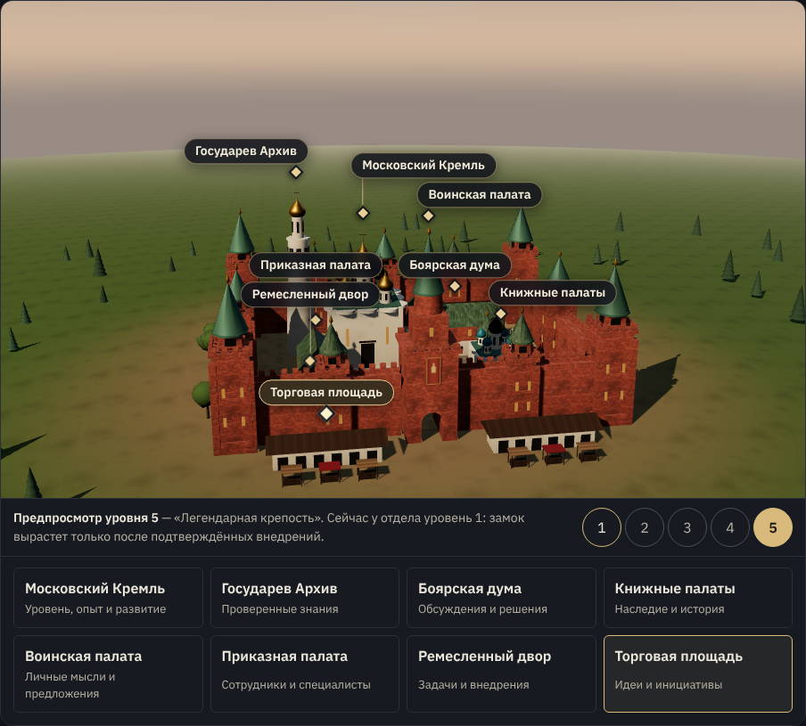
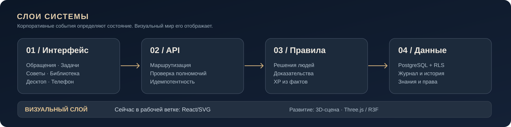

 

**КОРПОРАТИВНЫЙ СЕРВИС · ОБРАЩЕНИЯ · РЕШЕНИЯ · ЗНАНИЯ**

### Хорошие идеи не должны теряться.

**MODUS FLOW** — сервис, который помогает организациям слышать сотрудников, принимать обоснованные решения, проверять результат внедрения и сохранять полезный опыт.

[English](README.en.md) · [Возможности](#как-работает-сервис) · [Живое Содружество](#зачем-здесь-королевство) · [Технологии](#технологии-и-архитектура) · [Запуск](#как-запустить-демо)

---

## Сначала сервис. Затем — впечатление.

Каждый день в компаниях возникают идеи, проблемы, предложения и решения. Часть теряется в чатах, часть остаётся без владельца, а принятые меры бывает сложно проверить.

**MODUS FLOW связывает весь цикл в одну историю:** кто поднял вопрос, кто отвечает, какие аргументы были рассмотрены, какое решение принято, что внедрено и каков проверенный эффект. Вместо декоративного рейтинга — доказанный вклад. Вместо бесконечной переписки — понятный маршрут работы.

### Как работает сервис

| 01 / Сигнал | 02 / Ответственность | 03 / Решение |
|:--|:--|:--|
| Сотрудник сообщает о проблеме или предлагает улучшение. | Обращение направляется в подразделение, назначаются ответственные и сроки. | Уполномоченные люди рассматривают доводы, возражения и принимают решение. |
| **04 / Внедрение** | **05 / Доказанный результат** | **06 / Организационная память** |
| Исполнитель выполняет решение; статусы и действия фиксируются. | Подтверждённое внедрение и эффект отражаются в истории и развитии подразделения. | Кейс проходит путь от Летописи к Библиотеке решений и Высшему Архиву. |

**Ключевой принцип:** ИИ может помогать анализировать и предлагать варианты, но полномочия, ответственность и окончательное решение остаются у людей. Языковая модель необязательна и по умолчанию выключена: пока она не подключена, разбор честно называется разбором по правилам, а оценка ИИ — «не подключено».

## Зачем здесь королевство?

Потому что важные рабочие процессы можно показать наглядно, а не прятать в таблицах.

  
  Оригинальная брендовая анимация · Не видеозапись приложения и не готовый 3D-геймплей

### Королевская аудиенция · видеопревью

  
  Прототип анимации из механики аудиенции (PR #14). Сцена художественная, не запись готового 3D-геймплея.

Сотрудник отправляет посла по своему обращению. Король подтверждает приём, после чего отправитель видит сцену аудиенции. Затем возможны три **обычных, проверяемых действия**: вынести вопрос на рассмотрение, оформить решение о внедрении либо созвать Совет. Приём посла сам по себе **не означает одобрения обращения** и не меняет полномочия.

**Кинематографичные ролики для десктопа и мобильного интерфейса будем производить через [Google Flow](https://labs.google/fx/tools/flow).** Важный художественный стандарт: только безликие силуэты, никаких лиц и портретов. До появления утверждённого видео выше показана анимированная SVG-визуализация текущего прототипа.

[Механика аудиенции — PR #14](https://github.com/airtrio-security-lab/modus-flow/pull/14) · [План видеопроизводства в Google Flow](docs/GOOGLE_FLOW_CINEMATICS.md)

**«Великое Содружество» — визуальный интерфейс корпоративного сервиса.** Организация остаётся одной организацией. Её подразделения представлены районами общего мира: со своими зданиями, сотрудниками, инициативами и малыми советами. Большой Круглый стол объединяет все отделы.

| Визуальный стиль района | Архитектурный образ | Место обсуждения |
|:--|:--|:--|
| **Камелот** | Каменные замки, башни, рыцарские мастерские | Зал рыцарей |
| **Японский сёгунат** | Японские замки, сады, деревянные галереи | Зал даймё |
| **Казахское ханство** | Ханская орда, юрты, степное окружение | Ханская юрта |
| **Монгольская держава** | Ставка, кочевые поселения и укрепления | Совет нойонов |
| **Русское царство** | Кремль из красного кирпича, шатровые башни, белокаменные соборы, торг | Боярская дума |

**Визуальный стиль не влияет на права, полномочия, XP или карьерную оценку.** Игровые титулы — форма представления, а не реальные должности. Рабочий интерфейс доступен и без игровой карты.

  
  Снимок реального приложения на демо-данных (вымышленные сотрудники и обращения) · программный рендер, не видеозапись

  
  Снимок реального приложения: город района в 3D, подписанный предпросмотр уровня · демо-данные

## Видимый результат, а не придуманные очки

Система связывает развитие подразделения с проверяемыми событиями. В платформе XP начисляется через серверный журнал после подтверждённого внедрения и эффекта. Подразделение не получает опыт за простую отправку идеи. Повторная выдача за одно событие блокируется на уровне базы данных.

**Человек → обращение → решение → внедрение → доказательство → знание.**

## Технологии и архитектура

**В \`main\`** находится платформа на React / TypeScript / Node.js / PostgreSQL 16: обращения с маршрутизацией и сроками, решения с историей, разграничение доступа на уровне строк, Советы и заседания, знания, мобильный PWA. Город Содружества показан тремя способами: 3D-сцена на Three.js, схема (SVG) и обычная рабочая таблица — данные и права во всех трёх одни и те же. Ранняя автономная Node.js-демоверсия сохранена рядом.

| Слой | Технологии / подход |
|:--|:--|
| Платформа | React, TypeScript, Vite, Node.js, PostgreSQL 16, Row-Level Security |
| Данные и полномочия | API, серверные правила, аудит событий, идемпотентные начисления |
| Город Содружества | Three.js (процедурные модели и материалы, без сторонних ассетов), запасная SVG-схема, рабочая таблица |
| Город района | Нарисованная панорама (Камелот, Русское царство) и тот же город в 3D |
| Языковая модель | Необязательна и по умолчанию выключена; без неё интерфейс пишет «не подключено», шаблоны за ИИ не выдаются |
| Устройства | Десктоп и мобильный браузер |
| Ранняя демоверсия | Node.js, браузерный UI, тесты Node |

**Что ещё не сделано и не проверено.** 3D-сцена собрана из процедурной геометрии и уступает концепт-иллюстрациям выше; авторских 3D-моделей, движения гонцов и жителей нет. Частота кадров измерена на одном настольном компьютере (Chrome на Apple M5: медиана 5 мс между кадрами, p90 10 мс при ~600 тыс. треугольников), телефон — только в эмуляции: на слабых видеокартах и реальных телефонах производительность ещё предстоит проверить. Проверки проекта выполняются локально; GitHub CI сейчас не запускается.

> **Статус:** продукт развивается и **не готов к развёртыванию с реальными персональными данными** без полноценной авторизации, эксплуатационной инфраструктуры и юридических/безопасностных проверок. Демонстрационные сотрудники и обращения вымышлены.

## Как запустить демо

**Платформа с демо-данными** (macOS / Linux, Node.js ≥ 22.18, запущенный Docker для PostgreSQL 16; все сотрудники и обращения вымышлены):

~~~bash
git clone https://github.com/airtrio-security-lab/modus-flow.git
cd modus-flow
./scripts/demo-local.sh --fresh --dataset
# http://127.0.0.1:3100
~~~

Скрипт поднимает PostgreSQL в Docker, применяет миграции, загружает вымышленную организацию и открывает вход по демо-персонам (имитация SSO — только для показа). Подробности, тесты и локальные проверки — в [DEVELOPMENT.md](DEVELOPMENT.md); сценарий показа 3D-города — в [docs/demo/world3d-demo.md](docs/demo/world3d-demo.md).

**Ранняя автономная демоверсия** (без базы данных):

~~~bash
npm ci
DEMO_MODE=true npm start
# http://localhost:3000
~~~

Не публикуйте демосервер в интернет и не вводите реальные данные сотрудников: демодоступ намеренно небезопасен для публичного размещения.

## Художественное направление

**Качество изображения должно поддерживать доверие к сервису.** Наша цель — кинематографичная среда, правдоподобная архитектура, сдержанная палитра, чистая типографика и ощущение масштаба. Без копирования визуальных материалов Apple, Rockstar, Blizzard или других студий.

**Никаких человеческих лиц и фотореалистичных портретов.** В фирменных иллюстрациях, игровых аватарах и промоматериалах допускаются только обезличенные силуэты, фигуры со спины, гербы и символы. Силуэты не должны подменять реальные данные о работниках.

Полный стандарт: [Brand & Art Direction](docs/BRAND_DIRECTION.md).

## Разработка и доказательства

MODUS FLOW развивается в **Air Trio Security Lab**. Актуальные изменения и результаты проверяются в репозитории. Мы разделяем демонстрацию, реально работающие функции и концепцию будущего 3D.

**Для нас красиво — значит понятно. А полезно — значит проверяемо.**

---

### MODUS FLOW

**Сервис, который превращает обращения в решения, а решения — в организационный опыт.**

Air Trio Security Lab · Казахстан · Private repository · All rights reserved unless separately licensed

